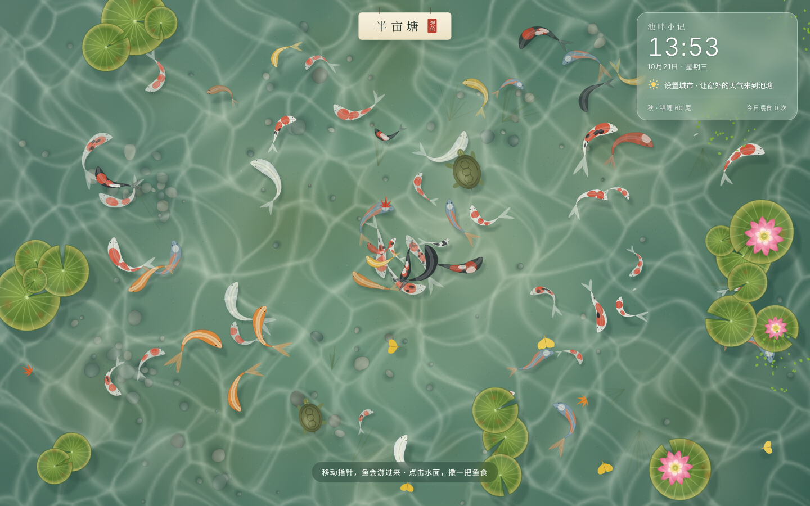
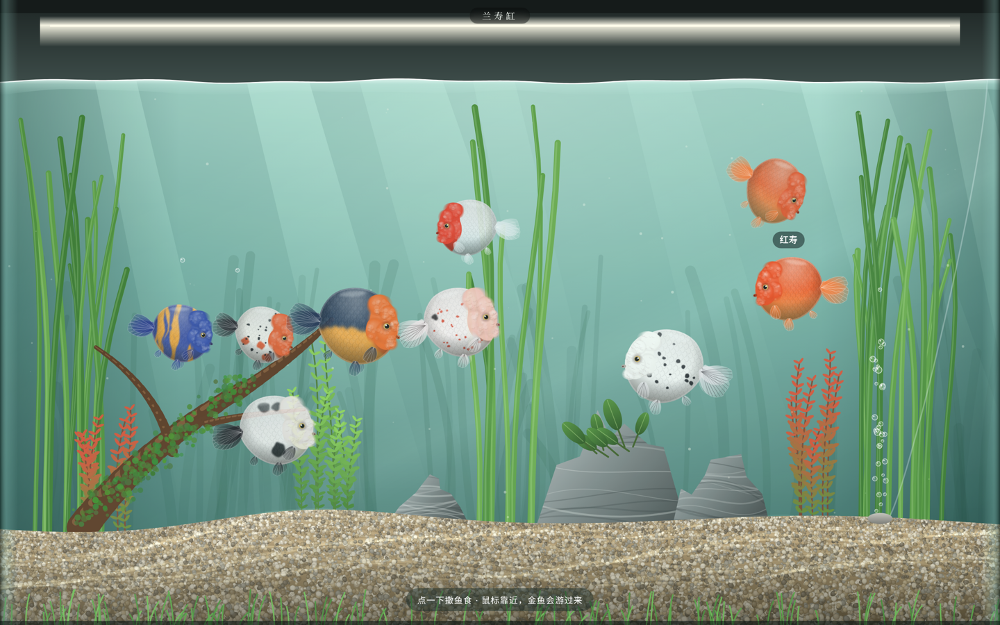
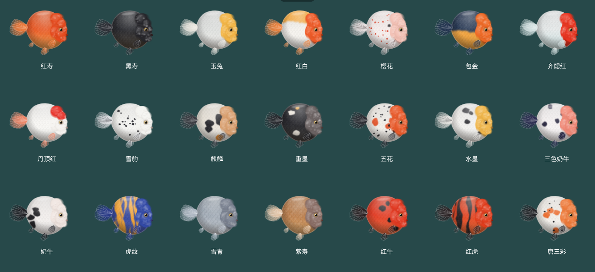

# 半亩塘 · Mac 桌面锦鲤池

> 半亩方塘一鉴开，天光云影共徘徊。

一个放在 Mac 桌面上的动态锦鲤池，参考了「碧潭观鱼」的玩法，画面和代码全部重新原创。



- 俯视锦鲤池：12 个品种（红白、大正三色、昭和、黄金、浅黄……），会结伴游、偶尔冲刺
- 移动指针，鱼会好奇地游过来；鼠标划得太快会把鱼吓散
- 点击桌面空白处撒一把鱼食，鱼会抢着吃
- 荷叶、荷花、浮萍、两只乌龟，偶尔飞来一只点水的蜻蜓
- 四季：春天漂花瓣，夏天荷花多，秋天落枫叶和银杏，冬天残荷
- 日夜：跟随真实时间（按所在城市的日出日落），夜里有月影和萤火虫
- 天气：设置城市后跟随真实天气（Open-Meteo，免费、无需 key），会下雨、下雪、打雷
- 右上角「池畔小记」：时间、天气、三天预报、今日喂食次数
- 支持多显示器；桌面被全屏应用遮住时自动降频，屏幕休眠、锁屏时暂停，省电

## 打包成 App（约 1 分钟）

**最省事：** 下载后双击文件夹里的 `双击安装.command`，会自动打包、放进「应用程序」并打开。第一次如果提示「无法验证开发者」，右键点它 → 打开。

也可以手动：

需要 macOS 12 或更新版本，以及 Xcode 或「命令行工具」。

1. 如果还没装过命令行工具，打开「终端」运行：
   ```bash
   xcode-select --install
   ```
2. 进入解压后的文件夹，运行打包脚本：
   ```bash
   git clone https://github.com/jinaiyingying-beep/banmu-pond.git
   cd banmu-pond
   ./build.sh
   ```
3. 会弹出 `build` 文件夹，把 **半亩塘.app** 拖进「应用程序」，双击打开。

打开后桌面就变成池塘了。程序坞里没有图标，所有设置都在**菜单栏的小鱼图标**里：撒鱼食、池塘名字、天气城市、鱼的数量、时间/天气/季节演示、显示开关、帧率、暂停、开机自动启动。

不需要任何系统权限（不读屏幕内容，不要辅助功能权限）。

## 第二个场景：兰寿缸

菜单栏小鱼图标 → **场景** → 「兰寿缸（正视）」，桌面就变成一个正面看的水草缸。



- 27 种兰寿花色：红寿、黑寿、玉兔、红白、樱花、包金、齐鳃红、丹顶红、雪豹、麒麟、重墨、五花、水墨、三色奶牛、奶牛、虎纹、雪青、紫寿、红牛、红虎、唐三彩、十一红、玉面通背、玉面红袍、龙鳞、熊猫、紫金寿
- 圆滚滚的身体、包住整个头的肉瘤、会反光的鳞片和半透明的鳍
- 点一下撒鱼食：先浮在水面再慢慢沉底，兰寿会抬头去啄
- 鼠标停在鱼身上，会显示它的品种
- 沉木、青龙石、苦草、有茎草、气石冒泡；晚上自动切成蓝色月光灯



## 建议改一个系统设置

macOS 14 起，点击桌面墙纸默认会把所有窗口推开（「点按墙纸以显示桌面」）。喂鱼时会很烦，建议改成：

**系统设置 → 桌面与程序坞 → 点按墙纸以显示桌面 → 仅在台前调度中**

## 只想先在浏览器里看看

直接用 Chrome 或 Safari 打开 `web/index.html` 就能玩，点「设置城市」可以填城市。

## 文件说明

```
banmu-pond/
├── build.sh              一键打包脚本
├── web/index.html        锦鲤池（Canvas 绘制，浏览器和 App 共用）
├── web/aquarium.html     兰寿缸
└── mac/
    ├── main.swift        Mac 外壳：桌面层窗口、菜单栏、鼠标转发、设置保存
    ├── Info.plist
    └── AppIcon.iconset/  应用图标
```

工作原理：每块屏幕放一个无边框窗口，层级在「壁纸之上、桌面图标之下」，里面用 WKWebView 渲染 `web/index.html`。窗口本身不拦截鼠标，所以桌面图标照常能点、能拖；App 用全局鼠标监听判断指针是否落在露出的桌面上，再把坐标转给池塘。

## 想改点什么

- 改鱼的花色、大小、数量：`web/index.html` 里的 `VARIETIES` 和 `Fish` 类
- 改池底、荷叶布局：`paintBottom()`、`layoutPads()`
- 改完重新运行 `./build.sh` 即可

## 已知限制

- 点在桌面图标上也会撒鱼食（图标本身仍正常响应）
- 鼠标在其他 App 窗口上时池塘不会响应，这是故意的
- 第一次用 SMAppService 设置开机启动，需要先把 App 放进「应用程序」文件夹
